# 05 — Architecture (HLD + LLD, consolidated)

> Build Pack v2.0 · Supersedes v1.0 docs 02–04 and v1.1 §3. Decisions and their alternatives: doc 13.

---

## 5.1 Shape of the system

ParallelFlow is two products joined by a contract:

1. **App platform (built from 16 Oct).** Identity, org hierarchy, RBAC, teams, projects, Arena, Private, bridge, artifacts, tasks, SDLC loop, routines, notifications, audit.
2. **Agent runtime.** The harness, sessions (tree + compaction), tools and skills, model access and, later, sandboxes. **Today** this is `apps/runtime`: the open-source **Pi** coding-agent harness behind a thin HTTP service, owned by the app team (ADR-035), with models reached through OpenRouter. **Later** it is **Tau**, the separate team's fork of Pi, dropped in behind the same contract. The thin-LLM stub runtime planned earlier was not built; the Pi runtime replaced the `apps/stub-runtime` placeholder on 17 Oct.

They talk only through the **Runtime Integration Contract v0.2** (doc 08; the YAML is at v0.2.1 with additive, optional fields):
- the app calls the runtime over HTTP + SSE, signed with a short-lived service JWT (`RUNTIME_JWT_KEY`);
- the runtime calls back into the app only through the **App Tools MCP server**, using session-scoped tool tokens.

Switching from Pi to Tau is a change of `RUNTIME_URL`, as long as Tau passes the same contract.

### 5.1.1 What runs today (Phase A, as built by 4 Nov 2026)

| Service | Path | Port | What it is |
|---|---|---|---|
| web | `apps/web` | 3000 | Next.js app. The browser calls only the web origin: `/v1/*` is proxied to the API by a fallback rewrite in `next.config.ts` (`API_URL`), so the API's cookies belong to the web origin. AI reply streams go through a Next route handler instead of the rewrite (the rewrite buffers and times out at 30 s) |
| api | `apps/api` | 4000 | NestJS 11 modular monolith. Besides the HTTP API it runs, in-process: AI turns (dispatch to the runtime and the SSE broadcaster), the arena git repositories, GitHub sync, the activity-log renderer and the nightly memory scheduler. Also the OpenAI-compatible model proxy for the VS Code extension (`/v1/llm/*`, ADR-037) |
| runtime | `apps/runtime` | 7070 (`/v1`) | RIC v0.2 over the Pi harness (ADR-035). One Pi session per `session_key`; OpenRouter models through the `parallelflow/auto` router and a key pool; connectors (external MCP servers); Vercel deploy tools. Session files on disk under `RUNTIME_DATA_DIR`. Details: doc 08 |
| app-tools | `apps/app-tools` | 4200 (`/mcp`) | MCP Streamable HTTP server. Verifies the HS256 tool token (`TOOL_TOKEN_KEY`) and runs each tool in the token's tenant: `withSystemJob` filtered to the token's project for an arena token, `withUser(on_behalf_of)` for a Private token (ADR-035) |
| worker | `apps/worker` | — | pg-boss outbox relay, consumers and housekeeping (F21-05, ADR-033). Built and tested, but `pnpm dev`, `pnpm demo` and the demo deploy leave it out: nothing user-visible depends on it yet |
| realtime | `apps/realtime` | — | **Not built** (a placeholder). The web polls instead: arena messages every 2 s, gate state every 5 s, the inbox every 15 s (SLICE_DEBT) |
| VS Code extension | `apps/vscode` | — | Runs the Pi coding agent locally (RPC mode) inside a folder fence with approval cards. Signs in with a device code and a bearer token (ADR-037); builds GitHub-connected arenas with the developer's own GitHub account (ADR-042). Shipped as a downloaded `.vsix` |

`pnpm dev` starts web, API and App Tools through turbo, and the runtime as a plain child process (Pi hangs under turbo's task runner on Windows). `pnpm demo` does one `next build` and starts the same four services without watchers. Local Postgres is optional: the dev database is on **Neon** (ADR-030). Redis, S3/MinIO and SES are not used by any code yet: file bytes live in Postgres (`blobs.content`, ≤ 10 MB), rate limits and idempotency in Postgres, invite email goes through SMTP (`SMTP_URL`, nodemailer). Each of these is a SLICE_DEBT line.



## 5.2 Technology stack (final for MVP)

This is the production target. Where Phase A uses something simpler, §5.1.1 and SLICE_DEBT say so.

| Layer | Choice | Notes |
|---|---|---|
| Web | **Next.js 15 (App Router), React 19, TypeScript, Tailwind, Radix/shadcn, TanStack Query, Zustand** | Design tokens from `docs/design/ParallelFlow_Brand_Template_v2.md` (monochrome; Figtree, Geist Mono); the running app is the UI reference |
| API | **NestJS 11 on Node 22 (TypeScript)**, modular monolith | Zod DTOs shared with web via `packages/contracts` |
| DB access | **Kysely** + plain SQL up/down migrations (Kysely Migrator, ADR-030) | Schema = `contracts/schema_v2.sql`; app connects as `saras_app` |
| Database | **PostgreSQL 16** (AWS RDS, Multi-AZ) + **pgvector** | RLS for tenant, Private and Arena visibility |
| Jobs & schedules | **pg-boss** (Postgres-backed queues, cron) | Outbox relay, notifications, routines, digests, evidence, retention, guest expiry |
| Cache / realtime fan-out | **Redis 7** (ElastiCache) | Pub/sub for WebSocket fan-out, authz fact cache, rate limits, presence |
| Realtime | Own WebSocket gateway (`ws`) | 5-minute tokens, topic authz, resume by seq |
| Files | **S3** (SSE-KMS), pre-signed uploads, ClamAV scan Lambda | Content-addressed artifact blobs |
| Auth | **WorkOS AuthKit + SSO + Directory Sync (SCIM)** | Google, Microsoft, magic link, SAML/OIDC, SCIM |
| Email | AWS SES | Invites, digests |
| Source control | Git repository per arena on the API's disk; the **ParallelFlow GitHub App** to mirror an arena to a GitHub repo (ADR-040, ADR-042) | Approved stage files are committed on each passed gate; once connected, GitHub is canonical and pull requests are mirrored from webhooks |
| Agent runtime | **Pi harness** (`@earendil-works/pi-coding-agent`) in `apps/runtime`, models through **OpenRouter** (ADR-035); Tau later behind the same RIC | Per-person or per-arena own provider keys (ADR-043) |
| Hosting | **AWS ap-south-1, ECS Fargate**, ALB, CloudFront + WAF, Terraform (ADR-024) | Simpler than Kubernetes for the MVP; Tau may run elsewhere. Interim demo deploy: one VM with Docker Compose + Caddy (§5.12) |
| Observability | OpenTelemetry → Grafana Cloud; Sentry; uptime checks | doc 11 |
| Product analytics & flags | PostHog (events + feature flags) | Ids only, no content |
| CI/CD | GitHub Actions → ECR → ECS (blue/green) | Preview environments per PR (P1) |

## 5.3 Monorepo layout

```
parallelflow/
├─ apps/
│  ├─ web/                 Next.js app (Private, Arena, setup, loop, dashboards, inbox, settings)
│  ├─ api/                 NestJS monolith (HTTP + adapter dispatch)
│  ├─ realtime/            WebSocket gateway
│  ├─ worker/              pg-boss consumers + cron (outbox, notifications, routines, evidence, retention)
│  ├─ app-tools/           MCP server exposed to the runtime
│  ├─ runtime/             RIC v0.2 over the Pi harness (ADR-035), connectors, Vercel tools, key relay
│  └─ vscode/              VS Code extension: Pi coding agent, folder fence, approvals (ADR-037, ADR-042)
├─ packages/
│  ├─ contracts/           Zod schemas → OpenAPI v2, RIC types, event types, role_templates_v2.json
│  ├─ db/                  migrations 0001–0017, Kysely types, tenant-context helpers, seed, recordArenaEvent
│  ├─ authz/               permission engine (doc 03 §3.8) — pure functions + exhaustive tests (Phase B)
│  ├─ domain/              state machines: cycle, gate, task, bind, routine, access request
│  ├─ runtime-client/      RIC client and types, SSE consumer, isolation guard, OpenRouter key pool
│  ├─ pi-parallelflow/     ParallelFlow Pi extension: context, guardrails, autonomy layer 1, ask_user,
│  │                       parallelflow/auto router, compaction, skills, slash commands, connector catalog
│  ├─ pi-swa/              SWA, the software architect extension (doc 15)
│  ├─ pi-pm/               Product Manager extension (private chats, ADR-039)
│  ├─ ui/                  design system components (tokens light/dark)
│  └─ observability/       OTel, logger with redaction
├─ deploy/azure/           interim demo deploy: docker-compose.yml + Caddyfile (one VM)
├─ Dockerfile              images for web and for api / runtime / app-tools
├─ scripts/                pnpm dev, pnpm demo, pnpm demo:check
├─ infra/terraform/        VPC, ECS, RDS, ElastiCache, S3, SES, WAF, secrets (Phase B, not yet in the repo)
├─ tests/                  e2e (Playwright), canary isolation suite, RIC conformance kit (Phase B, not yet in the repo)
└─ docs/                   this Build Pack
```

Today unit tests sit next to the code (`*.test.ts`) and integration tests too (`*.int.test.ts`, Testcontainers or `TEST_DATABASE_URL`).

## 5.4 API module map (bounded contexts)

| Module | Owns tables | Key responsibilities |
|---|---|---|
| `identity` | users | Session, `/me`, WorkOS callback/webhooks |
| `org` | organizations, org_policies, org_memberships, invitations, knowledge_sources | Org, policies, directory, invites, offboarding |
| `units` | org_units, unit_role_assignments | Hierarchy, unit roles, dashboards scope |
| `teams` | teams, team_members | Teams and team roles |
| `projects` | projects, project_roles, role_capabilities, project_members, project_member_roles, stage_gate_policies, agent_policies, access_requests | Setup wizard, RBAC data, access |
| `arena` | arenas, messages, message_mentions | Arena stream, mentions, moderation |
| `private` | private_sessions, bridge_events | Private sessions, bind, pull context |
| `artifacts` | blobs, artifacts, artifact_versions, evidence, files | Versions, push, uploads, evidence |
| `tasks` | tasks | Tasks, delegation, AI teammate, verify |
| `loop` | sdlc_cycles, stage_transitions, approval_requests, approval_votes | Cycles, gates, votes, progress.md |
| `routines` | routines, routine_runs | Schedules and runs |
| `runtime` | agents, agent_sessions, runtime_turns, app_tool_calls | Adapter, turn ledger, usage |
| `messaging` | dm_threads, dm_participants (+messages) | DMs |
| `notify` | notifications, notification_prefs | Routing, inbox, email digest |
| `audit` | audit_events, outbox_events, processed_events | Audit chain, outbox |
| `search` | (views + FTS indexes) | ACL-filtered search |

Boundary rules:
- A module touches only its own tables.
- It reads other modules through their service interfaces.
- Cross-module side effects go through outbox events (enforced by lint rules plus DB grants per schema in production).

**As built (Phase A).** `apps/api/src` has these folders: `identity`, `pipeline` (the request pipeline, §5.5), `arenas`, `invites`, `roles`, `loop`, `private`, `bridge`, `artifacts`, `files`, `notifications`, `agent` (AI turns: runner, broadcaster, output filter and paste guard as the backstop to the runtime's guardrails), `events` (arena events), `progress` (PROGRESS.md activity log), `memory` (knowledge graph and nightly STATE.md), `repo` (arena git repositories), `github` (GitHub App and pull request mirror), `code` (coding sessions and in-app pull requests), `ext` (extension device-code sign-in and bearer tokens), `llm` (model proxy for the extension), `extensions` (Private extensions marketplace and connections), `ai-keys` (own AI provider keys), `mail`, `health`. Units, org admin, routines, DMs, search and tasks have no module yet (ADR-029 hides them in the MVP). Phase A runs side effects such as invite emails, git commits, GitHub sync and AI turns in-process after the commit, not as outbox jobs (each is a SLICE_DEBT line).

## 5.5 Request lifecycle (LLD)

1. **Edge:** CloudFront/WAF → ALB → `api`.
2. **Middleware order:**
   1. request id (`X-Request-Id`, kept if well formed, else a new UUIDv7) and one access-log line per request;
   2. session/bearer auth → principal `{user_id}` (pluggable `SessionVerifier`; routes are authenticated unless `@Public()`);
   3. per-user rate limit, so probing unknown ids is limited too;
   4. org membership status check: the tenant comes only from the path id of a `@ProjectScoped` / `@OrgScoped` route, through `withProjectMember` / `withOrgMember` (ADR-031). No membership or unknown id → 404; suspended, deprovisioned or expired guest → 403 `MEMBERSHIP_INACTIVE`. Then the per-org rate limit;
   5. idempotency (`Idempotency-Key`, 24 h; `@Idempotent()` routes), inside the handler transaction;
   6. Zod validation;
   7. **authz** (`packages/authz`, facts cached by `membership_version`);
   8. handler, which receives the transaction (`@DbTx()`) and never picks a database context itself;
   9. problem+json mapper.

   **Step 2 as built (F01-01, ADR-032):** `WorkosSessionVerifier` reads `parallelflow_session`, checks its MAC and the 12 h / 2 h limits, verifies the WorkOS access token (refreshing it once if expired), loads the account in user scope (exists, not deactivated, same email), and checks `X-CSRF-Token` on POST/PUT/PATCH/DELETE (403 `FORBIDDEN`). A bad or expired session clears the cookies and answers 401. Without WorkOS configuration the API runs with no verifier: every authenticated route is 401.

   **Slice implementation (F21-04):** rate limits and idempotency records are stored in Postgres (`rate_limit_counters`, `idempotency_keys`, migration 0004), not Redis, until realtime brings Redis (SLICE_DEBT). Rate limits are fixed one-minute windows, each counted in its own short transaction before the handler. The idempotency check, the handler and the stored 2xx response share one transaction, so a response is stored only if the handler's writes commit; a concurrent duplicate gets 409 `CONFLICT` (advisory lock). `X-ParallelFlow-Org` is not read yet: no route needs it until multi-org users exist. authz (step 7) lands with `packages/authz` (F08-01).
3. **DB transaction:**
   - `SET LOCAL app.org_id`, `app.user_id` (and `app.system_job` for workers);
   - domain writes, `audit_events` (risk ≥ medium) and `outbox_events` all in **one transaction**.
4. **After commit:**
   - the outbox relay (pg-boss job every 250 ms or LISTEN/NOTIFY) enqueues consumer jobs;
   - Redis publish for realtime.

   **Outbox as built (F21-05, ADR-033):**
   - **Emit:** producers call `emit(tx, event)` from `packages/db` inside the handler transaction. It validates the doc 07 §7.5 envelope (Zod registry in `packages/contracts/src/events.ts`: ids and enums only, strict objects, at most 4 KB), assigns a UUIDv7 id, and inserts only if `org_id` is the transaction's tenant (`OutboxTenantMismatchError` otherwise). The event commits or rolls back with the change.
   - **Relay:** `apps/worker` polls in a loop, not as a pg-boss job: every 250 ms while rows arrive, at once after a full batch, doubling to 2 s when idle (`OUTBOX_POLL_MS`, `OUTBOX_IDLE_MAX_MS`, `OUTBOX_BATCH_SIZE`). An idle poll is one `EXISTS` query. A busy poll is one transaction as the `saras_relay` login: claim up to 100 rows `ORDER BY created_at FOR UPDATE SKIP LOCKED`, insert one pg-boss job per subscribed consumer through the same transaction (job id = event id), set `published_at`. Two relays never publish a row twice; a crash before commit publishes nothing. A row that fails validation (only raw SQL can write one) is published without jobs and logged by id. No LISTEN/NOTIFY yet (SLICE_DEBT).
   - **Consumers:** `defineConsumer({ name, events, handler, retry })`, one queue `consumer.<name>` each. A job re-validates the event, opens `withSystemJob` for its org (app role), inserts `(consumer, event_id)` into `processed_events` `ON CONFLICT DO NOTHING` and runs the handler only if the row is new; both commit together. A throw rolls both back and pg-boss retries with exponential backoff (default 6 retries starting around 5 s, capped at 10 min), then moves the job to `consumer.<name>.dead` (kept 14 days for inspection or `redrive`). Logs carry ids, types, counts and durations only; the error pg-boss stores names the error class only.

## 5.6 Realtime

- `POST /v1/realtime/token` → 5-minute JWT.
- WebSocket `wss://rt.parallelflow.app/v1/ws`.
- **Topics:**
  - `arena:{project}`;
  - `private:{session}` (owner only);
  - `dm:{thread}`;
  - `user:{id}` (notifications);
  - `turn:{turn}`.
- Subscribing is authorized with the same authz engine. On membership changes, the gateway force-unsubscribes.
- Frames carry a per-topic `seq`. On reconnect, the client sends `resume` and the gateway replays the last 500 frames from a Redis list, or tells the client to refetch over REST.
- REST is the only write path. WebSocket is for delivery only.

**As built (Phase A): no gateway.** `apps/realtime` is a placeholder. The web polls REST: arena messages every 2 s while the tab is visible (`?after=` cursor, backing off to 30 s on errors), gate state every 5 s, the inbox every 15 s. A live AI reply streams to the person who asked over SSE from the API's in-memory per-turn broadcaster; teammates see the final message on their next poll. This works on a single API instance only (SLICE_DEBT Demo 4). The gateway above is Phase B.

## 5.7 Runtime adapter (inside `api` + `worker`)

| Concern | Design |
|---|---|
| Session provisioning | On setup complete: `POST /sessions` with `session_key`, profile `central_arena`, `context_seed` (org brief, project brief, roles, gates) and a tool token. Retries with backoff. Status in `agent_sessions` |
| Turn dispatch | `runtime_turns` row (id = idempotency key) → `POST /sessions/{id}/turns` with `mode`, input, `app_state` (cycle, stage), effective `autonomy`, `task_ref` / `routine_ref` |
| Event ingest | Worker consumes SSE: deltas → Redis publish (`turn:{id}`, `arena:{project}`). `message.completed` → persist agent message. `artifact.proposed` → draft artifact. `approval.requested` → approval card. `turn.completed` → usage |
| Isolation guard | Before every dispatch, recompute the expected `session_key` from the project or private session and compare. Mismatch → refuse, alert, audit |
| Ambient batching | Arena messages not addressed to `@central` are batched (20 messages / 60 s) as `reply_expected=false` |
| Fallback | If the runtime is unavailable: human chat continues, the agent is marked degraded, routines digest/nudge use deterministic templates, turns fail with `RUNTIME_UNAVAILABLE` |
| Budgets | Per-org monthly budget (Billing admin). Turns refused with `BUDGET_EXCEEDED` at 100%, alerts at 80% |

**As built (Phase A).** The adapter lives in the API only (`apps/api/src/agent`); the worker has no AI path. A turn runs in-process after its request commits (no pg-boss job), with a 30 per minute per person limit in memory. The API reads the runtime's SSE stream, relays text to the asker through the broadcaster, stores the final message, turns `artifact.proposed` into a saved document (shown as a file card, never pasted into the chat) and `question.asked` into a multiple-choice question card. A turn sent while the AI is replying waits in the runtime's per-session follow-up queue. Each private turn carries the person's installed extensions (`extensions`, ADR-039) and each reply turn carries the own AI key to use, if any (`model_key`, ADR-043). The arena's AI is told about gates, send-backs and new members through `system` turns. Ambient batching, routines and budgets are not built yet.

## 5.8 App Tools MCP server

- Streamable HTTP MCP endpoint.
- Bearer **tool token** carries `session_key`, `org_id`, `project_id`, principal (central agent / personal agent on behalf of a user), scopes and expiry (≤60 min).
- Every tool call runs this pipeline: resolve resources → reject anything outside `token.project_id` (`SCOPE_MISMATCH`) → authz (capability of the on-behalf-of user, or central-agent grant) → **autonomy check** (class from `app-tools_v0.2.mcp.json`; `approve` → creates an approval and returns `APPROVAL_REQUIRED`) → execute → log `app_tool_calls`.
- 20 tools in the original v0.2 list; the contract file now lists 26 (additions include `files.list`, `files.read`, `private.list_artifacts`, `private.read_artifact`, `ask.question` and `memory.recall`). The human-only list is never exposed (doc 08).
- **As built (ADR-035):** the tool token is HS256-signed with `TOOL_TOKEN_KEY` by the API and verified here. An arena token opens `withSystemJob` for its org with every query filtered to its project; a Private token opens `withUser(on_behalf_of)`. Positive membership checks and agent policies are cached 30 s in memory, and the `app_tool_calls` row is written after the reply (SLICE_DEBT Perf). Gate requests and refused tools also write an arena event (ADR-044).

## 5.9 Jobs and schedules (pg-boss)

| Queue | Trigger | Job |
|---|---|---|
| `outbox.relay` | Continuous | Move outbox rows to consumer queues. **As built:** a polling loop in `apps/worker`, not a queue (§5.5) |
| `consumer.<name>` / `consumer.<name>.dead` | Domain events | One queue per consumer (F21-05) and its dead-letter queue |
| `housekeeping.outbox_cleanup` | Cron hourly (`17 * * * *`, UTC) | Delete outbox rows published more than 7 days ago (doc 06 §6.6) |
| `housekeeping.idempotency_sweep` | Cron every 15 min (UTC) | Delete expired `idempotency_keys` rows (F21-04) |
| `notify.fanout` | Domain events | Route notifications (doc 04 §4.12), apply prefs, publish realtime |
| `routine.tick` | Cron every minute | Find due routines → enqueue `routine.run` with unique `(routine, slot)` |
| `routine.run` | Tick | Dispatch `mode=routine` turn or deterministic fallback |
| `loop.after_transition` | Stage transition | Stage summary, `progress.md`, system turn, evidence commit |
| `evidence.git` | Approved stage artifact | GitHub App commit `.parallelflow/cycles/{n}/{stage}.md`, retries |
| `members.guest_expiry` | Daily | Warn at 7 days, suspend at expiry |
| `members.offboard` | Offboarding | Revoke sessions, remove memberships, flag owner-less projects |
| `private.retention` | Daily | Delete Private content after retention for deprovisioned users |
| `knowledge.index` | Upload | Parse, chunk, embed (pgvector) |
| `approvals.expire` | Hourly | Expire stale approvals, notify requesters |
| `audit.archive` | Nightly | Export to S3 (Object Lock) |

pg-boss (12.35.1) lives in schema `pgboss`, installed and upgraded by the owner during `pnpm db:migrate`. The worker runs it as the `saras_relay` login on a direct endpoint with `migrate: false` and `reindex: false` (ADR-033). Queues are not partitioned: a partitioned queue would need `CREATE` at runtime.

**As built (Phase A).** Only the relay, the consumer framework and the two housekeeping crons exist in the worker; no domain consumer is registered yet, and the worker is not started by `pnpm dev`, `pnpm demo` or the demo deploy. The scheduled work that the product needs today runs **inside the API process** instead, each a SLICE_DEBT line paid back by a pg-boss job:

| Work | Trigger | Where |
|---|---|---|
| PROGRESS.md render from arena events (ADR-044) | ~60 s after an arena's last event (at most 5 min), at once on a gate decision | API, debounced in memory |
| Nightly memory and STATE.md chapter (ADR-045) | Scheduler every 15 min; an arena's day D is told from 00:30 local time on D+1; up to 7 missed days caught up, failed days retried 3 times | API, one in-memory job per arena; assumes one API instance |
| Gate commit to the arena git repo | Passed gate | API, after the vote commits (no retry) |
| GitHub sync (push after a gate commit, fetch after a webhook) | Gate, webhook, connect | API, per-arena git queue (ADR-040) |

## 5.10 Caching

| Data | Where | Invalidation |
|---|---|---|
| Authz facts (org role, unit roles, team roles, project capabilities) | Redis `authz:{org}:{user}:v{membership_version}` | Bump `membership_version` on any membership/role change |
| Project progress | Redis `progress:{project}:{tasks_version}` | `tasks_version` bump trigger |
| Role templates / capability catalogue | In-process | Deploy |
| Dashboard aggregates | Redis, 60 s | TTL |

**As built (Phase A):** no Redis. The API caches GET responses in memory for up to 30 s per user and URL (`pipeline/read-cache.ts`, dropped by this process's writes; `API_READ_CACHE=off` turns it off), and a verified session's account check for 30 s. App Tools caches membership checks and agent policies for 30 s. Extension bearer checks are cached 30 s. All are per process, so they assume one instance (SLICE_DEBT Perf).

## 5.11 Errors and resilience

| Class | Handling |
|---|---|
| Validation / authz / domain guard | 4xx problem+json with stable code (doc 07 §7.4); no retry |
| Transient DB / Redis | Client retries with the same Idempotency-Key (exponential backoff + jitter, max 3) |
| Runtime unavailable | Degrade (above); banner in Arena; turns can be retried |
| GitHub / SES failures | Job retries up to 24 h; evidence shows `pending` / `failed` |
| Concurrency on gates | `SELECT … FOR UPDATE` on approval + cycle `version` check; double advance impossible |

## 5.12 Deployment topology

| Service | ECS tasks (min / max) | Scaling signal |
|---|---|---|
| web (Next.js) | 2 / 8 | CPU / requests |
| api | 2 / 10 | CPU / p95 latency |
| realtime | 2 / 6 | Connections per task (~5k) |
| worker | 2 / 8 | pg-boss queue depth |
| app-tools | 2 / 6 | Requests |
| runtime (Pi harness until Tau is certified) | 1 / 2 | — (sessions on a persistent disk) |

Data: RDS PG16 `db.r7g.large` Multi-AZ + 1 read replica (search, dashboards) · ElastiCache Redis `cache.r7g.large` · S3 · SES.

This AWS topology (ADR-024) remains the production target for Phase B. Terraform is not written yet.

**Interim demo deploy (in progress, Nov 2026).** One VM (Azure for Students) running Docker Compose from `deploy/azure/docker-compose.yml`, built from the repo's `Dockerfile`:
- `web` (target `web`: `next build` + `next start` on 3000, built with `API_URL=http://api:4000` because the proxy target is fixed at build time);
- `api` (4000), `runtime` (7070) and `app-tools` (4200), all target `service`, run from TypeScript with `tsx` (no compiled build, SLICE_DEBT F21-04), as the non-root `node` user;
- `caddy` (2.8.4): the only public ports (80/443), automatic Let's Encrypt HTTPS for `DOMAIN`, reverse proxy to `web:3000` with `flush_interval -1` so AI reply streams pass straight through;
- volumes: `api_data` (arena git repositories at `ARENA_REPOS_DIR=/data/arena-repos`), `runtime_data` (Pi session files at `RUNTIME_DATA_DIR=/data`), `caddy_data` (certificates).

Secrets come from `.env.production` on the VM (never committed). The database is Postgres outside the VM (`DEPLOY_PLAN.md` calls for a Neon project separate from the dev database, ADR-030). The worker is not deployed (nothing depends on it yet). Plan and checklist: `DEPLOY_PLAN.md`.

Environments:

| Environment | Notes |
|---|---|
| `local` | `pnpm dev` or `pnpm demo` on the developer's machine; dev database on Neon (ADR-030). `docker compose up -d` offers Postgres + pgvector, Redis, MinIO and Mailpit, but only Postgres (when not on Neon) and Mailpit (optional SMTP) are used today |
| `demo` | The one-VM Docker Compose deploy above |
| `preview` | Per PR, P1 |
| `staging` | Synthetic orgs + dogfood |
| `prod` | — |

## 5.13 Capacity estimate (year 1)

| Driver | Assumption | Load |
|---|---|---|
| Users | 5,000 (DAU 50%) | — |
| Arena messages | 40 / DAU / day | ~100k/day, ~15/s peak |
| Agent turns | 10 / DAU / day + routines | ~30k/day |
| Storage | Messages ~1 KB; artifacts ~30 KB/version | < 200 GB year 1 |

The bottleneck is model latency and cost in the runtime, not the app. Back-pressure points are: turn queue, budgets, ambient batching.

## 5.14 What we'd change at scale

| Trigger | Change |
|---|---|
| > 5k orgs or DB CPU > 60% sustained | Split `arena` and `messaging` into their own service and database |
| > 50M vectors | Dedicated vector store |
| Many event consumers or replay needs | Kafka/Redpanda behind the outbox |
| Regulated enterprise deals | Single-tenant cells, BYO runtime / model keys, additional regions |

## 5.15 Integrations and arena data (as built, Phase A)

### Arena git repositories
Each arena has a git repository on the API server's disk (`ARENA_REPOS_DIR`, default `.data/arena-repos/<project>`). A passed gate commits the stage's approved files. The repo holds stable paths: `README.md`, `AGENTS.md`, `PROGRESS.md`, `STATE.md`, `docs/<stage>/`, `docs/product/` and `docs/design/architecture/<SWA path>`, with history in `git log` (ADR-040). Arena files must have a standard name (`plan`, `requirements`, `hld`, …; ADR-038). Coding sessions from the VS Code extension push git bundles here and merge reviewed in-app pull requests into `main` (ADR-037).

### GitHub App (ADR-040, ADR-042)
- **Connect (owner only):** signed state → the ParallelFlow GitHub App's install page → Setup URL → GitHub OAuth for the app (the person's token is used once to check access to that installation, then dropped) → the owner picks one repository. Stored in `arena_github_repos` (migration 0011).
- **Once connected, GitHub is canonical.** Gate commits and in-app merges fetch, go on top of origin, push without force and retry a rejected push (3 tries). Push and merged pull-request webhooks fast-forward the arena repo.
- **Installation tokens** are minted on demand (RS256 app JWT), limited to the one repo and to contents RW, pull requests RW, metadata R, cached in memory until 5 minutes before expiry, never stored or logged, and given to git only as an `http.https://github.com/.extraHeader` through `GIT_CONFIG_*` environment variables.
- **Webhooks** are checked with `X-Hub-Signature-256`, then run under the credential scope (ADR-037); each delivery id is processed once (`github_webhook_deliveries`).
- **Pull requests:** developers build in VS Code with VS Code's own GitHub sign-in, push their branch and open the pull request on GitHub as themselves. Pull-request webhooks upsert a read-only mirror row in `pull_requests` (migration 0013); review and merge happen on GitHub.
- Setup steps for the app: `docs/github-app-setup.md`. Without the six `GITHUB_APP_*` / `GITHUB_WEBHOOK_SECRET` variables, arenas stay on the server.

### Own AI keys (ADR-043)
`ai_provider_keys` (migration 0015) holds one key per person (their private chats) or per arena (its AI), for one of Pi's native providers (OpenAI, Anthropic, DeepSeek, OpenRouter, Google, Groq, Mistral, xAI, Together, Fireworks) and a model from Pi's catalogue. The API checks the key once with the provider, then seals it with **AES-256-GCM** under a key derived (HKDF-SHA256) from `WORKOS_COOKIE_PASSWORD`, the same connections key that seals Linear credentials (ADR-039); only the last 4 characters are shown. Each reply turn carries `model_key`; the runtime holds it in memory for that session, tries it first, and falls back to ParallelFlow's key pool when the provider refuses it, logging only provider and status.

### Activity log (ADR-044)
Every API change to an arena writes one `audit_events` row through `recordArenaEvent` (`<area>.<thing>.<verb>`, metadata ids, names and counts only, never content). A BEFORE INSERT trigger (migration 0016) chains each arena's rows under an advisory lock: `hash = sha256(prev_hash || canonical row)`; the app never computes a hash. Rows are readable only by the arena's members and system jobs. **PROGRESS.md** is rendered from these events deterministically (no AI), the last 60 days in the file and older months in `docs/progress/YYYY-MM.md`.

### Memory and STATE.md (ADR-045)
The arena's memory is a knowledge graph in Postgres (`kg_nodes`, `kg_edges`, `kg_sources`, `state_days`, `memory_schedule`; migration 0017), not a graph database. The API's scheduler tells each arena's day once it is over in the arena's time zone: collect messages, events, approved files and PRs → skip quiet days without an AI call → the arena's AI as a read-only Pi fork (`extract-memory` skill, so the arena's own key applies) returns strict JSON → deterministic merge into the graph → `narrate-day` writes the chapter. **STATE.md** and `docs/state/graph.json` are rendered from the graph; they go to the repo only when it has no GitHub remote or the GitHub repo is private. The App Tool `memory.recall` lets the AI search the graph. No embeddings yet.

### Connectors and deploy tools (runtime)
External MCP servers the arena's AI may use, listed in `RUNTIME_CONNECTORS` (catalog in `packages/pi-parallelflow/src/connectors.ts`, launch in `apps/runtime/src/connectors.ts`):
- **draw.io** (default): `@drawio/mcp`, a pinned dependency run with the runtime's own Node, never `npx`. Sandboxed with Node's permission model (reads only installed packages and its own folder, writes only its folder, no child processes), a preload that turns child-process calls into polite failures, and an environment built from nothing (it never sees the OpenRouter key, signing keys or other sessions' data).
- **Sentry** (`https://mcp.sentry.dev/mcp`, `SENTRY_AUTH_TOKEN`) and **Semgrep** (`https://mcp.semgrep.ai/mcp`, no key; the code it scans is sent to Semgrep): vendors' hosted servers reached through Pi's HTTP transport, arena AI only, read-only tools. A remote connector whose required key is empty is skipped.
- **Linear** (`https://mcp.linear.app/mcp`): the Product Manager extension in private chats only, with the person's own sealed key (ADR-039).
- **Vercel deploy tools** (`apps/runtime/src/vercel.ts`): three read-only REST tools (`vercel_list_deployments`, `vercel_get_deployment`, `vercel_build_errors`) with one server-wide `VERCEL_TOKEN` (optional `VERCEL_TEAM_ID`). REST, not MCP, because Vercel's hosted MCP server takes only OAuth from approved clients.

One Sentry and one Vercel account serve every arena for now (SLICE_DEBT); per-arena sealed connections are Phase B.

### VS Code extension (`apps/vscode`, ADR-037, ADR-042)
Signs in with a device code; the API stores the bearer token as a SHA-256 hash (30 days, revocable). Runs the Pi coding agent locally in RPC mode with the ParallelFlow and SWA Pi extensions, a folder fence and approval cards. Model calls go through the API's `/v1/llm/*` proxy with ParallelFlow's key pool, so no provider key sits on a laptop; a developer can instead run the agent on their own Claude subscription. For GitHub-connected arenas it clones the repo, branches per story and opens the pull request on GitHub (ADR-042).
