# 06 — Data Model

> Build Pack v2.0 · Source of truth: `contracts/schema_v2.sql` (PostgreSQL 16 + pgvector). Supersedes `schema.sql` v1.0 and `schema_v1.1.sql`.
> Validated on PostgreSQL 16.15: 45 tables (+4 monthly message partitions), 2 views, RLS on 41 tables, 27 seeded capabilities.
> After migrations 0002–0005: 47 tables, forced RLS on 45 (the 41 tenant tables, `users`, `organizations`, `idempotency_keys`, `rate_limit_counters`). 0005 adds no table: 4 policies for the relay role and the `pgboss` schema (ADR-033).
> After migrations 0006–0017: 63 tables, forced RLS on 61. The live schema is `schema_v2.sql` plus every later migration; see [Changes since schema v2](#68-changes-since-schema-v2-migrations-00020017).

---

## 6.1 Entity relationships

The diagram shows schema v2 (the baseline) only. It does not show the tables added by migrations 0004–0017 (§6.8).

## 6.2 Table catalogue

| Area | Tables | Notes |
|---|---|---|
| Organization | `organizations`, `org_policies`, `org_memberships`, `invitations` | Preset, WorkOS ids, region; one policy row per org; membership has role, status, home unit, level/title (metadata), reports_to, guest expiry, `membership_version` |
| Hierarchy | `org_units`, `unit_role_assignments` | Tree ≤5 levels, materialised `path` for subtree queries; Unit Lead / Unit Admin |
| Teams | `teams`, `team_members` | Unit link, team role owner/admin/member, team defaults |
| Identity & agents | `users`, `agents` | One personal agent per (org, user); one central agent per org (identity only; brains in Tau) |
| Projects & RBAC | `projects`, `capabilities`, `project_roles`, `role_capabilities`, `project_members`, `project_member_roles`, `stage_gate_policies`, `agent_policies`, `access_requests` | System roles (owner/observer) + custom roles; 27 capabilities (28 with `pr.merge`, 0008); gate SoD controls; autonomy per class. `projects` gains `deleted_at` / `deleted_by` (soft delete, 0009) and `timezone` (0017); `project_roles` gains `stages` (the SDLC stages a role works in, 0012) |
| Arena & sessions | `arenas`, `agent_sessions`, `messages` (partitioned), `message_mentions` | Exactly one Arena and one agent session per project; messages belong to exactly one of arena / private session / DM |
| Private & bridge | `private_sessions`, `private_projects`, `bridge_events` | Private rows have `org_id` NULL (0006). Write-once `bound_project_id`; `private_project_id` files a chat in a folder; every crossing audited (`copy_from_arena` added in 0012) |
| Private extensions & keys | `user_extensions`, `user_connections`, `ai_provider_keys` | Installed extensions (`swa`, `pm`) and connected services (`linear`, credential sealed by the API) per person (0010). Own AI provider key per person or per arena, sealed, only `key_last4` shown (0015) |
| VS Code extension sign-in | `ext_device_codes`, `ext_access_tokens` | Device-code sign-in and bearer tokens, stored as SHA-256 hashes; credential scope RLS (0008) |
| Code | `coding_sessions`, `pull_requests`, `pr_reviews`, `arena_github_repos`, `github_webhook_deliveries` | AI coding sessions on `ai/*` branches, in-app PRs and their reviews (0008); GitHub PR mirror columns (0013); the arena's connected GitHub repo and webhook delivery ids (0011, `repo_private` in 0017) |
| Arena memory | `memory_schedule`, `kg_nodes`, `kg_edges`, `kg_sources`, `state_days` | Knowledge graph and nightly STATE.md chapters per arena (0017) |
| DMs | `dm_threads`, `dm_participants` | User-to-user only |
| SDLC loop | `sdlc_cycles`, `stage_transitions`, `approval_requests`, `approval_votes`, `evidence` | One active cycle; append-only transitions |
| Work | `tasks` | Agent assignee requires reviewer; completion requires verifier |
| Artifacts | `blobs`, `artifacts`, `artifact_versions` | Content-addressed; one approved version. Private files are org-less (0007). `artifacts` gains `deleted_at` / `deleted_by` (0009) and, on private copies of arena files, `upstream_project_id` / `upstream_artifact_id` / `upstream_version_no` (0012) |
| Routines | `routines`, `routine_runs` | Cron + timezone; unique run per slot |
| Runtime ledger | `runtime_turns`, `app_tool_calls` | Turns, usage, every tool call |
| Notifications | `notifications`, `notification_prefs` | 10 types; dedupe key |
| Events & audit | `outbox_events`, `processed_events`, `audit_events` | Outbox, idempotent consumers, hash-chained audit. Since 0016 `audit_events.project_id` names the arena, a trigger fills `prev_hash` / `hash` per arena chain, and the rows are the arena's activity log. Envelope → columns: `subject` → `aggregate_id`, `topic` = type prefix, `{actor, time, trace_id, schema_version, data}` → `payload` (doc 07 §7.5, F21-05) |
| Request pipeline (F21-04, migration 0004) | `idempotency_keys`, `rate_limit_counters` | Not tenant tables (no `org_id`). Stored 2xx responses per (user, Idempotency-Key) for 24 h; fixed one-minute request counters per user, per org, and (0008) per user for the `llm` proxy. Postgres until Redis lands (SLICE_DEBT) |
| Views | `member_capabilities`, `org_dashboard_projects` (+ `project_progress` derivable) | `security_invoker = true` so the caller's RLS applies |

## 6.3 Invariants enforced by the database

| Invariant | Mechanism | Verified |
|---|---|---|
| Tenant isolation | RLS `tenant_isolation` (FORCE) on 41 tables via `app.org_id` | ✓ |
| Identity tables are not global | RLS on `users` (self, verified sign-in email, co-members of the current org) and `organizations` (current org; your active orgs in user scope). ADR-031 | ✓ `identity-scope.int.test.ts` |
| Cross-arena reads are own-rows only | User scope (nil `app.org_id`): your memberships, projects and orgs; no tenant content. ADR-031 | ✓ |
| Tenant comes from a verified membership | `withOrgMember` / `withProjectMember` check an active membership, then set the tenant in the same transaction. No membership → `NotVisibleError` (404); your own membership suspended, deprovisioned or an expired guest → `MembershipInactiveError` (403 `MEMBERSHIP_INACTIVE`). ADR-031, F21-04 | ✓ |
| Idempotency records are owner-only | FORCE RLS on `idempotency_keys`: `user_id = current_user_id()` for read and write; system jobs and identity scope see nothing | ✓ `request-pipeline.int.test.ts` |
| Rate-limit counters: own user, current org only | FORCE RLS on `rate_limit_counters`: `user` bucket = current user, `org` bucket = current org (tenant context, reached via a verified membership) | ✓ |
| The relay role sees only outbox rows (all orgs) and can only delete expired idempotency rows | `saras_relay` (no BYPASSRLS): `SELECT`, `DELETE`, `UPDATE (published_at)` on `outbox_events`, `DELETE` on `idempotency_keys`, nothing else in `parallelflow`. `TO saras_relay` policies: read all, publish once (`published_at` NULL → value), delete only 7 days after publish, sweep only `expires_at < now()`. ADR-033 | ✓ `outbox-relay.int.test.ts` (written; first run pending) |
| Events are emitted in the change's transaction, for its tenant only | `emit` inserts only when `org_id = current_org_id()`; RLS `tenant_isolation` WITH CHECK as backstop | ✓ `outbox-relay.int.test.ts` (written; first run pending) |
| Every app-readable table has forced RLS | Catalog test; the only exceptions are `capabilities` (read-only catalogue) and `processed_events` (consumer ids) | ✓ `tenant-isolation.int.test.ts` |
| Private is owner-only | RESTRICTIVE policies on `private_sessions`, private `artifacts`, private messages | ✓ |
| Private belongs to no org | `org_id IS NULL` on Private rows, enforced by CHECKs: `private_sessions.org_id IS NULL`; messages `private_session_id IS NOT NULL` ⇔ `org_id IS NULL`; agents `kind = 'personal'` ⇔ `org_id IS NULL`; agent_sessions `kind = 'private'` ⇔ `org_id IS NULL` (`runtime_turns` / `app_tool_calls` of private sessions are org-less too). `tenant_isolation` never matches NULL, so no tenant context or system job sees them. PERMISSIVE `private_space_*` policies let only the owner reach them, in user scope only. One personal agent per person (`agents_one_personal_per_user`). ADR-034 | ✓ `visibility.int.test.ts`, `tenant-isolation.int.test.ts` (written; first run pending) |
| Private files belong to no org | `artifacts`: `(scope = 'private') = (org_id IS NULL)`; `blobs`: org or `owner_user_id`, never both; `artifact_versions.blob_owner_user_id` set exactly for org-less versions, with FKs `(org_id, blob_sha256)` and `(blob_owner_user_id, blob_sha256)`; trigger `artifact_versions_match_artifact` keeps a version with its artifact's owner. PERMISSIVE `private_space_artifacts` / `_artifact_versions` / `_blobs`, user scope only. In-database content (`blobs.content`, Phase A) xor `s3_key`, ≤ 10 MB. ADR-034 (0007) | ✓ `visibility.int.test.ts` (written; first run pending) |
| Private projects are the owner's folders | FORCE RLS on `private_projects`: `user_id = current_user_id()` in user scope; a chat can only be filed in your own project; deleting a project sets `private_sessions.private_project_id` NULL (chats move to Recent). ADR-034 | ✓ (written; first run pending) |
| A person's extensions, connections and own AI key are owner-only | FORCE RLS, `private_space_extensions` / `private_space_connections` / `private_space_ai_keys`: `user_id = current_user_id()` in user scope only, so no tenant context sees them. Secrets are sealed by the API (AES-256-GCM); the database never holds them in clear text. ADR-039, ADR-043 | — |
| An arena's AI key is one per arena and tenant-scoped | `ai_provider_keys_one_owner` CHECK (a person, or an org + project, never both); unique per user and per project; `tenant_isolation` on project rows. Members read provider, model and `key_last4`; the API lets only the owner write. ADR-043 | — |
| Credential scope: rows found by a secret, not by a tenant | `app.credential` = SHA-256 of the secret the caller sent (device code, access token, GitHub repo / installation id, webhook delivery id, `memory-scheduler`). `ext_device_codes`, `ext_access_tokens`, `github_webhook_deliveries` and the read-only `github_repos_by_webhook` / `memory_schedule_by_scheduler` policies match only that hash. Other contexts set `''` and see nothing (except your own access tokens in user scope). No SECURITY DEFINER. ADR-037, ADR-040, ADR-045 | — |
| Soft-deleted files and arenas are hidden | `deleted_at` / `deleted_by` on `artifacts` and `projects`; RESTRICTIVE `artifacts_not_deleted` / `projects_not_deleted` FOR SELECT (system jobs still see them); `projects_archived_or_deleted` CHECK; the stage-document and lineage unique indexes ignore deleted rows (0009, 0014). ADR-038 | — |
| A private copy of an arena file names its upstream, private rows only | `artifacts_upstream_private_only` CHECK: all three `upstream_*` columns or none, only when `scope = 'private'`. No FK across the tenant boundary. ADR-041 | — |
| A PR author cannot approve their own PR | RESTRICTIVE INSERT `pr_reviews_by_reviewer`: the reviewer is the signed-in user, and an `approve` from the PR's author is rejected. GitHub-mirrored PRs (`github_number` set) are reviewed and merged on GitHub only. ADR-037, ADR-042 | — |
| An arena's activity log and memory are member-only | RESTRICTIVE SELECT `audit_events_project_members` and `kg_nodes_members` / `kg_edges_members` / `kg_sources_members` / `state_days_members`: arena members and system jobs only, on top of `tenant_isolation`. ADR-044, ADR-045 | — |
| Audit rows chain per arena | BEFORE INSERT trigger `audit_events_chain`: under a per-arena advisory lock, takes the id and sets `hash = sha256(prev_hash || audit_event_canonical(row))`. The app never sends a hash; `audit_append_only` still forbids changes. ADR-044 | — |
| Arena content is member-only (org admins and unit leads are not implicit members) | RESTRICTIVE `message_visibility` | ✓ Unit Lead (non-member) reads 0 messages |
| Observers cannot post | RESTRICTIVE INSERT `arena_post_requires_capability` (needs `arena.post`) | ✓ insert rejected |
| One Arena per project; one agent session key | `arenas.project_id UNIQUE`, `agent_sessions.session_key UNIQUE` | ✓ |
| One Owner role and one Observer role per project | partial unique index on `(project_id, system_kind)` | ✓ |
| Owner role has all capabilities | `member_capabilities` view grants all to `system_kind='owner'` | ✓ 27 |
| Private session binds once | trigger `bound_project_write_once` | ✓ |
| One active cycle per project | partial unique index | ✓ |
| Approval gates name approver roles | CHECK on `stage_gate_policies`; `min_distinct_roles ≤ min_approvals` | ✓ |
| Guests must expire | CHECK on `org_memberships` | ✓ |
| AI-teammate tasks need a human reviewer; completion needs a verifier | CHECKs on `tasks` | ✓ |
| Audit, transitions and bridge events are append-only | `forbid_mutation` triggers | ✓ |
| One pending access request per user per project | partial unique index | — |
| Routine runs are idempotent | `UNIQUE (routine_id, scheduled_for)` | — |

"✓" means the invariant was exercised in the v2 smoke test against PostgreSQL 16 (see `build/schema_v2_smoke.txt`) or in the named integration test. "—" means not yet listed as verified here.

## 6.4 Key rules not expressible in SQL (enforced in `packages/domain`)

- Every project keeps ≥1 member holding the Owner role (checked on remove/role change).
- An approval gate's roles must each have ≥1 member when the gate is used. Deleting a role or removing the last holder is blocked with `GATE_UNSTAFFED`.
- Agent autonomy ≤ org ceiling ≤ unit override (the effective policy is computed on read and sent to the runtime).
- Cross-unit membership allowed only if `allow_cross_unit_projects`.
- Guests cannot hold the Owner role, create teams, or see the directory beyond co-members.

## 6.5 Indexing and partitioning

| Query | Index |
|---|---|
| Arena / Private / DM history | `messages (arena_id / private_session_id / dm_thread_id, created_at DESC)` partial indexes; monthly partitions (pg_partman creates 3 ahead) |
| Unit subtree dashboards | `org_units (org_id, path text_pattern_ops)` |
| My projects | `project_members (user_id, last_opened_at DESC)` |
| Board | `tasks (project_id, status)` |
| Due routines | `routines (next_run_at) WHERE enabled` |
| Inbox | `notifications (user_id, created_at DESC) WHERE resolved_at IS NULL` |
| Search | GIN on generated `tsvector` columns; pgvector HNSW on knowledge chunks (P1) |

## 6.6 Retention

| Data | Default | Configurable by |
|---|---|---|
| Arena messages, artifacts, transitions | Life of project + 1 year after decommission | Security admin (P1) |
| Private content of deprovisioned users | 30 days, then deleted | `org_policies.private_retention_days_after_leave` |
| Audit events | 400 days hot, 7 years in S3 Object Lock | Security admin |
| Runtime turns / tool calls | 400 days | — |
| Outbox | 7 days after publish (`housekeeping.outbox_cleanup`, hourly) | — |
| Idempotency records | 24 h (expired rows of a user are deleted on that user's next idempotent request, and by the `housekeeping.idempotency_sweep` cron every 15 min, F21-05) | — |
| Rate-limit counters | Current window only (older windows deleted when a subject starts a new one) | — |

## 6.7 Migrations

- Tool: Kysely Migrator with plain SQL files `packages/db/migrations/NNNN_name.up.sql` / `.down.sql` (ADR-030).
- `schema_v2.sql` is byte-identical to the baseline migration `0001_baseline.up.sql` (a unit test checks it, so the file is never edited). The live schema = this baseline + migrations 0002–0017. Later changes are incremental files. `0002_app_role` creates the `saras_app` role the app connects as. `0003_identity_rls` adds RLS on `users` / `organizations` (ADR-031). `0004_request_pipeline` adds `idempotency_keys` and `rate_limit_counters` (F21-04). `0005_outbox_relay` adds the `saras_relay` role, its grants and policies, and the empty `pgboss` schema (ADR-033). `0006_private_space` makes Private org-less (nullable `org_id` + CHECKs on the six private tables, owner-only `private_space_*` policies, one personal agent per user) and adds `private_projects` with `private_sessions.private_project_id` (ADR-034). `0007_private_files` makes private artifacts, versions and blobs org-less (blobs get a uuid primary key, `owner_user_id`, `name` and in-database `content`; versions get `blob_owner_user_id`; three more `private_space_*` policies; ADR-034 extension). 0008–0017 are listed in §6.8. After the SQL migrations, `pnpm db:migrate` installs or upgrades pg-boss in that schema as the owner and provisions the app and relay logins.
- Commands: `pnpm db:migrate`, `pnpm db:migrate:down` (one step), `pnpm db:reset`, `pnpm db:codegen` (Kysely types into `packages/db/src/schema.gen.ts`).
- Rules:
  - every migration has a tested down;
  - expand → migrate → contract;
  - `CREATE INDEX CONCURRENTLY` on big tables (in its own non-transactional step);
  - each migration is reviewed with its RLS impact;
  - new `messages` partitions get no grants for `saras_app`;
  - CI applies all migrations to a fresh database, runs down and up again, and runs the RLS / isolation suite (`packages/db/src/*.int.test.ts`).

## 6.8 Changes since schema v2 (migrations 0002–0017)

`schema_v2.sql` is migration 0001. The live schema is that file plus the migrations below, in `packages/db/migrations/NNNN_name.up.sql`. RLS models: **tenant** = `tenant_isolation` on `org_id = current_org_id()`; **owner-only private** = `user_id = current_user_id()` in user scope, no tenant context sees it; **credential scope** = row visible only under the SHA-256 of a secret the caller sent (`app.credential`, ADR-037); **relay** = `TO saras_relay` policies.

| Migration | ADR | Tables / columns added | RLS model |
|---|---|---|---|
| 0002_app_role | ADR-030 | Role `saras_app` (no BYPASSRLS) the app connects as; no table | — |
| 0003_identity_rls | ADR-031 | Helper functions `current_user_id()`, `current_org_id()`, `in_user_scope()`, `current_auth_email()`, `is_system_job()`; RLS on `users` and `organizations`; own-row user-scope policies on `org_memberships`, `project_members`, `projects` | Identity / user scope |
| 0004_request_pipeline | — (story F21-04) | `idempotency_keys`, `rate_limit_counters` (no `org_id`) | Owner-only (own user; org bucket = current org) |
| 0005_outbox_relay | ADR-033 | Role `saras_relay`, schema `pgboss`; policies on `outbox_events` and `idempotency_keys`; no table | Relay |
| 0006_private_space | ADR-034 | `org_id` nullable + CHECKs on `private_sessions`, `messages`, `agents`, `agent_sessions`, `runtime_turns`, `app_tool_calls` (Private has `org_id` NULL); table `private_projects`; `private_sessions.private_project_id` (ON DELETE SET NULL) | Owner-only private (`private_space_*`) |
| 0007_private_files | ADR-034 (extension) | `org_id` nullable on `artifacts`, `artifact_versions`, `blobs`; `blobs.id` (new primary key), `owner_user_id`, `name`, `content`; `artifact_versions.blob_owner_user_id`; trigger `artifact_versions_match_artifact` | Owner-only private |
| 0008_ext_coding | ADR-037 | `ext_device_codes`, `ext_access_tokens`; `coding_sessions`, `pull_requests`, `pr_reviews`; capability `pr.merge`; `llm` bucket on `rate_limit_counters`; functions `current_credential()`, `signed_in_user()` | Credential scope (ext tables); tenant + RESTRICTIVE `pr_reviews_by_reviewer` (code tables) |
| 0009_soft_delete | ADR-038 | `artifacts.deleted_at` / `deleted_by`, `projects.deleted_at` / `deleted_by`; stage-document index ignores deleted rows | RESTRICTIVE SELECT hides deleted rows (system jobs see them) |
| 0010_user_extensions | ADR-039 | `user_extensions`, `user_connections` | Owner-only private |
| 0011_github | ADR-040 | `arena_github_repos`, `github_webhook_deliveries` | Tenant + credential scope (webhook read); deliveries credential scope only |
| 0012_arena_copy | ADR-041 | `artifacts.upstream_project_id` / `upstream_artifact_id` / `upstream_version_no` (private rows only); bridge crossing `copy_from_arena`; `project_roles.stages` | Unchanged (existing policies cover the columns) |
| 0013_github_pulls | ADR-042 | `pull_requests.github_number`, `html_url`, `github_state`, `head_ref`, `author_login`; `author_user_id` nullable for GitHub rows | Unchanged (tenant) |
| 0014_lineage_ignores_deleted | — (follow-up to ADR-038) | No column; the one-copy-per-lineage index ignores deleted arena files | — |
| 0015_ai_provider_keys | ADR-043 | `ai_provider_keys` (a person's key or an arena's key, sealed, `key_last4`) | Owner-only private (user rows) + tenant (arena rows) |
| 0016_arena_events | ADR-044 | `audit_events.project_id`; trigger `audit_events_chain` fills `prev_hash` / `hash` (columns from v2) per arena | Tenant + RESTRICTIVE members-only SELECT |
| 0017_arena_memory | ADR-045 | `projects.timezone`, `arena_github_repos.repo_private`; `memory_schedule` (kept by a trigger on `projects`), `kg_nodes`, `kg_edges`, `kg_sources`, `state_days` | Tenant + RESTRICTIVE members-only SELECT; `memory_schedule` also credential scope (`memory-scheduler`, read only) |

ADR-032 (web session), ADR-035 (Pi runtime and App Tools) and ADR-036 (loop routes) changed no schema.
