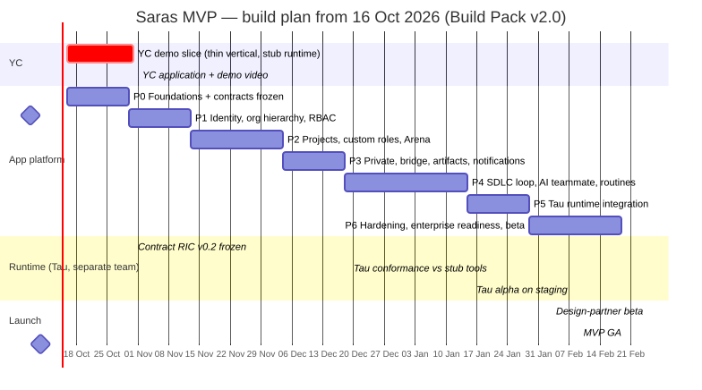

# 12 — Delivery Plan, YC Demo Slice & Backlog

> Build Pack v2.0 · Start: **Friday 16 Oct 2026** · MVP GA target: **Monday 22 Feb 2027**
> Detailed stories: `ParallelFlow_MVP_Backlog_v2.xlsx` (77 stories · 365 points). Capacity sheet: 6 engineers × 8 pts × 9 sprints = 432 pts → 84% planned utilisation.

---

## 12.1 Timeline

| Phase | Dates | Outcome | Exit criteria (demo on staging) |
|---|---|---|---|
| **YC demo slice** | 16 – 30 Oct | Thin end-to-end slice for the application video | Login → org → project with custom roles → Arena chat with `@central` (stub thin-LLM) → Private draft → Push to Arena → gate approve. Recorded 3-min video (doc 01 §1.9). **Actual:** replaced by Phase A (§12.2.1): arena-first sign-up with no org step (ADR-029), @AI on the Pi runtime (ADR-035) |
| **P0 Foundations** | 16 – 29 Oct | Monorepo, CI, Terraform, schema_v2, RLS harness, request pipeline, outbox, design system, stub runtime | Fresh `terraform apply` + `pnpm dev`; tenant suite green; RIC v0.2 frozen (C1). **Actual:** monorepo, CI, schema_v2 migrations, RLS tenant suite, request pipeline and outbox built by 16 Oct; Terraform not started; the Pi runtime replaced the stub |
| **P1 Identity, hierarchy, RBAC** | 30 Oct – 12 Nov | WorkOS auth/SSO, orgs & presets, policies, units & unit roles, members/invites/guests/offboarding, teams, authz library, audit | MNC demo: enterprise org with 3 units, Unit Lead, guest with expiry; authz matrix tests ≥95% branches |
| **P2 Projects, roles, Arena** | 13 Nov – 3 Dec | Setup wizard (templates, custom roles, gates, agent), members & roles, observers, Arena realtime, `@central` on stub, App Tools, canary suite v1 | Create "Enterprise product squad" project with custom role; observer read-only; canary 100% |
| **P3 Private, bridge, artifacts, notifications** | 4 – 17 Dec | Private sessions, bind / pull / push, artifacts & versions, delegation, notification centre, DMs | Bind write-once demo; push with gate request; 10 notification types |
| **P4 Loop, AI teammate, routines** | 18 Dec – 14 Jan | Cycles, gates with SoD, evidence, progress.md, AI-teammate tasks, routines, access requests, dashboards | Full cycle with 2-approver DEPLOY, no self-approval; AI task → review → verify; daily digest posts; Unit Lead dashboard |
| **P5 Tau integration** | 15 – 28 Jan | Swap the Pi runtime → Tau (same RIC), ambient batching, step drawer, usage & budgets | Conformance ≥95%, canary 100%, p95 first event < 3 s (C3 by 14 Jan) |
| **P6 Hardening & beta** | 29 Jan – 18 Feb | Load, pen test, search, SCIM, observability, email digest, audit UI; design-partner beta from 1 Feb | Launch checklist (§12.6) green |
| **GA** | 22 Feb 2027 | — | — |

The holiday period (late December) is inside P4, so P4 runs 4 weeks.

**Change of plan (16 Oct): product first, hardening second.** The phases above were replanned into **Phase A** (every visible feature end to end, for the YC video) and **Phase B** (production hardening). Phase A ran from 15 Oct to 9 Nov 2026 and is recorded in §12.2.1; what moves to Phase B is in §12.2.2. The dates of P1–P6 above are the original plan and need replanning from Phase B's start.

## 12.2 YC demo slice — day by day (16–30 Oct)

| Day | Date | Backend | Frontend | Platform |
|---|---|---|---|---|
| 1 | Fri 16 | Repo, NestJS skeleton, schema_v2 migration, seed | Next.js shell, tokens, mode switcher | AWS account, Terraform base, CI |
| 2–3 | Mon 19 – Tue 20 | WorkOS login; orgs; teams (minimal) | Login, onboarding (org step) | Staging ECS + RDS |
| 4–5 | Wed 21 – Thu 22 | Projects + setup:complete (templates, roles, gates; no units) | Setup wizard (roles + gates screens) | Stub runtime thin-LLM deployed |
| 6–7 | Fri 23 – Mon 26 | Arena messages, realtime, `@central` turns via adapter | Arena screen (stream, approval card) | Seed demo org/data |
| 8–9 | Tue 27 – Wed 28 | Private sessions, push to Arena, gate request + vote | Private home/session, push dialog | Monitoring basics |
| 10 | Thu 29 | Bug bash; demo script dry-run | Polish | Freeze staging |
| 11 | Fri 30 | **Record demo video**; submit YC application | — | — |

Slice rules:
- Code goes to `main` behind feature flags.
- Shortcuts are listed in `SLICE_DEBT.md` and paid back in P1–P3 (e.g. no units, simplified authz checks enforced by RLS only, single org preset).

The day-by-day table above is the original plan. It was replaced on 16 Oct by the Phase A build order in `CLAUDE.md` (app shell → first run → arena chat → @AI → Private → push and file viewer → stage strip and approvals → custom roles → demo data and deploy) and by ADR-029 (no visible org layer, no setup wizard). In practice the work happened on branch `feat/demo-first-run` (about 150 commits, not yet merged to `main`), with one commit per working feature tagged `[demo]`.

### 12.2.1 What Phase A delivered (15 Oct – 9 Nov 2026)

| Dates | Delivered | Decisions |
|---|---|---|
| 15–16 Oct | Foundations: pnpm/turbo monorepo with lint, typecheck, unit tests and CI (contract checks on PRs); schema_v2 migrations, `saras_app` role and the RLS tenant suite; identity RLS; the request pipeline (auth, tenant resolution, idempotency, rate limits, problem+json); WorkOS AuthKit sign-in, sessions and CSRF; transactional outbox with the pg-boss relay | ADR-030 – ADR-033 |
| 16 Oct | Build-order steps 1–6: app shell and top bar, sign-in and empty home; create arena, invite links and join; same-origin `/v1` proxy; arena chat with polling and members panel; @AI with streaming replies; Private without an org, private chats and Projects sidebar; private files; push to arena, bring context, uploads | ADR-029, ADR-034 |
| 17 Oct | The Pi runtime behind RIC v0.2 and the App Tools MCP server; model fallback; step 7 (stage strip, gate requests and approvals) and step 8 (custom roles with templates); invites by email; the AI reads files (including PDF text); a git repository per arena, committed on every approved gate | ADR-035, ADR-036 |
| 18 Oct | Inbox and notifications; arena files and threads; AI guardrails (names, no ids or tool names); saved documents as file cards; multiple-choice questions from the AI; System/Light/Dark theme; full-screen file reading; VS Code extension: device-code sign-in, bearer tokens, LLM proxy, Pi in RPC mode with a folder fence, approvals, coding sessions and reviewed pull requests | ADR-037 |
| 19 Oct | ParallelFlow Pi extension: model routing (FAST/STRONG), skills and slash commands; slash commands in the composer; follow-up queue; the AI told about gates and members; draw.io, the first connector | — |
| 21–22 Oct | SWA, the software architect extension (intake, stack, HLD, LLD, conformance review, change impact), in VS Code, arenas and private chats; the owner approves architecture documents in the viewer | doc 15 |
| 23–24 Oct | Rename Saras → ParallelFlow (database names kept); coding agent on the developer's own Claude subscription; models' real limits from OpenRouter's catalog; files filed in SDLC stage folders; monochrome theme and new logo; PROGRESS.md and STATE.md pinned | — |
| 26 Oct | Standard file names and soft delete for files and arenas; owner actions; real draw.io diagrams edited inside the app | ADR-038 |
| 27–28 Oct | Private extensions marketplace (SWA moved out of the arena); Product Manager extension with Linear; per-chat file side panel; connect an arena to GitHub through the ParallelFlow GitHub App | ADR-039, ADR-040 |
| 29 Oct | Copy arena files into a private chat and push back to the same file; stage handoff to the roles of the next stage; drag and drop between folders, chats and arenas; build GitHub-connected arenas in VS Code and open pull requests on GitHub; "Build in VS Code" in one click | ADR-041, ADR-042 |
| 30 Oct | OpenRouter key pool; `pnpm demo:check` preflight; Thinking / Reasoning / Articulating status in AI replies; push folders; 15-minute turns | — |
| 3 Nov | Sentry and Semgrep MCP connectors and Vercel deploy tools for the arena AI; bring your own AI provider key; arena activity log as a hash-chained event stream (PROGRESS.md rendered from it) | ADR-043, ADR-044 |
| 4 Nov | Arena knowledge graph and the nightly STATE.md story | ADR-045 |
| 9 Nov | Dockerfile and one-VM Docker Compose + Caddy deploy; the running app and brand template v2 become the UI reference (old design screens deleted) | — |

Build-order status: steps 1–8 are done. Step 9 is partly done: there is a seed script (`pnpm db:seed`, 2 arenas, 3 users), but the demo plan (`DEMO_PLAN.md`) builds the video's data through the real app instead; the deploy is in progress (below). Migrations 0001–0017 exist; the project owner applies them.

**Deploy status (9 Nov):** the images and the Compose file are committed (`Dockerfile`, `deploy/azure/`). The target is one Azure VM running web, API, runtime and App Tools behind Caddy with automatic HTTPS; the worker is not deployed. Bringing the VM up, the production database, WorkOS production redirect and the live smoke test are still open (`DEPLOY_PLAN.md` steps 2–8). Doc 05 §5.12 has the topology.

### 12.2.2 What moves to Phase B

Phase B follows the order in `CLAUDE.md`, story by story from `docs/backlog/backlog.csv`, then pays back `SLICE_DEBT.md`:
1. **Authz library** (`packages/authz`) and every endpoint enforcing its `x-required-permission`; gate rules (`min_approvals`, `min_distinct_roles`, `forbid_self_approval`) on the server. Phase A uses owner/member checks.
2. **Realtime:** Redis and the WebSocket gateway (`apps/realtime`), replacing polling and the single-instance SSE broadcaster.
3. **Tau via the runtime contract:** certify the Pi runtime, then Tau, against RIC (agree the v0.2.1 additions with the Tau team first).
4. **Contract tests** (OpenAPI and RIC conformance) and the canary isolation suite.
5. **Security scanners** (Semgrep, CodeQL, gitleaks in CI).
6. **Terraform** and the AWS topology (ADR-024), replacing the one-VM deploy.
7. **The full Definition of Done** (doc 11 §11.4) on every story.
8. **SLICE_DEBT.md** pay-back. The largest items: in-process work that should be pg-boss jobs (AI turns, PROGRESS.md renders, the nightly memory scheduler, gate commits, GitHub sync, invite emails); in-memory caches and limiters that assume one API instance; file bytes in Postgres instead of S3 with a virus scan; sealed keys under a derived key instead of a secret store or KMS; one server-wide Sentry and Vercel account; no embeddings for memory; GitHub pull requests not linked to people; the `.vsix` downloaded by hand; database names still `saras`.

Also deferred by ADR-029 (not built for the MVP): org units and dashboards, org policies and presets, SSO/SCIM, guests, access requests, setup wizards, routines, the AI teammate's task assignments, DMs, budgets and search.

## 12.3 Team and ownership

| Role | People | Owns |
|---|---|---|
| Tech lead / backend | 1 | Contracts, authz, loop, adapter, code review of security-critical paths |
| Backend | 2 | Org / units / teams / members; Arena / realtime / DMs; Private / bridge / artifacts / tasks / routines |
| Frontend | 2 | Design system, Private, Arena, setup wizard, loop, dashboards, inbox, settings |
| Platform / QA | 1 | Infra, CI/CD, observability, canary and tenant suites, load tests |
| Product / design (founder) | 1 | Scope, backlog, design canvas, design partners, YC application |
| Tau runtime team | Separate | Tau harness, RIC wrapper, conformance (doc 08 §8.8) |

## 12.4 Ceremonies

- 2-week sprints starting Monday 19 Oct (the YC slice runs inside sprint 1).
- Daily 15-minute standup. **We dogfood:** run ParallelFlow itself in a ParallelFlow Arena as soon as P2 lands, with a daily digest routine.
- Sprint review = staging demo against the phase exit criteria.
- Weekly 30-minute contract sync with the Tau team.
- Architecture decisions recorded in doc 13 (append-only).

## 12.5 Risks

| Risk | L | I | Mitigation | Owner |
|---|---|---|---|---|
| YC slice too ambitious for 2 weeks | M | H | Thin scope, RLS-first authz, explicit slice debt. (Outcome: Phase A ran about 3½ weeks, to 9 Nov, with a large SLICE_DEBT) | Tech lead |
| Slice debt outgrows Phase B | H | H | One line per shortcut in `SLICE_DEBT.md`; Phase B order fixed in `CLAUDE.md`; single-instance assumptions listed | Tech lead |
| RBAC complexity slows P1–P2 | M | H | Authz as pure library with matrix tests; templates reduce UI surface | Tech lead |
| Tau slips | M | M | The Pi runtime (`apps/runtime`, ADR-035) already powers every AI feature behind the same RIC; checkpoints with fallbacks | Founder + Tau lead |
| Model cost | M | M | Budgets, batching, routine minimum interval, model classes | Backend |
| Enterprise asks (SAML/SCIM) early | M | M | WorkOS covers them; SCIM in P6 | Backend |
| Scope creep (voice, Developer mode, channels) | H | M | Non-goals list (doc 02 §2.2); decision log | Founder |

## 12.6 Launch checklist (GA)

- [ ] Golden-path E2E green for 7 consecutive days on staging
- [ ] Tenant, Private, canary isolation and authz suites 100%
- [ ] Unit Lead and Org Admin cannot read Arena content of non-member projects (verified in a prod-like environment)
- [ ] External pen test: no open High / Critical
- [ ] SLO dashboards and alerts live; runtime-down and isolation runbooks rehearsed
- [ ] Backup restore drill done (RPO ≤ 5 min, RTO ≤ 1 h)
- [ ] Privacy notice, DPA, sub-processor list published
- [ ] Budgets on for every org; billing plan configured
- [ ] Design partners' feedback triaged; P0 issues closed

## 12.7 Decisions to confirm with founders (defaults used in this pack)

| # | Question | Default |
|---|---|---|
| D1 | Can org admins read Arena content of projects they're not in? | No; they request access |
| D2 | Team ↔ project | A team owns many projects; members can come from other teams/units if policy allows |
| D3 | Parallel cycles | No; one active plus operating cycles |
| D4 | Agent replies on someone's behalf | Not in MVP |
| D5 | Rebinding a private session | Never; start a new session |
| D6 | Hosting | AWS ECS Fargate, ap-south-1 |
| D7 | Auth vendor | WorkOS |
| D8 | Plans and prices | After design-partner interviews |
